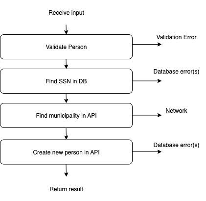
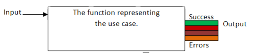

<!-- .slide: data-background="#003d73" -->
## Functional error handling 

 <!-- .element style="width: 200px; position: fixed; bottom: 50px; left: 50px" -->

----

### Agenda

* Problem<br/><!-- .element: class="fragment" -->
* Result / Either monad<br/><!-- .element: class="fragment" -->
* Monadic error handling<br/><!-- .element: class="fragment" -->
  * Composition
  * Conversion
  * Exceptions && Parallel validation

---

### Problem

* A 'normal' program consists of
  1. Input validation<br/><!-- .element: class="fragment" -->
  2. Reading data from db/api<br/><!-- .element: class="fragment" -->
  3. Complete functions in business logic<br/><!-- .element: class="fragment" -->
  4. Updating data in db<br/><!-- .element: class="fragment" -->
  5. Accessing network<br/><!-- .element: class="fragment" -->
  6. Showing results<br/><!-- .element: class="fragment" -->
* <br/><div><b>Note</b>: Some contains I\O operations - we solve that next time</div><!-- .element: class="fragment" -->

----

#### Happy path

```fsharp
let useCase (json:string) =
  let person = validatePerson json
  let ssn = db.readSSN person
  let bornIn = api.findMunicipality ssn
  let newData = createNewPerson bornIn
  db.updateMunicipality newData
```

All functions are on the form
<!-- .element: class="fragment" data-fragment-index="1" -->

```fsharp
'input -> 'output
```
<!-- .element: class="fragment" data-fragment-index="1" -->
and are therefore easily composable<!-- .element: class="fragment" data-fragment-index="1" -->


Note:

```fsharp
type person = {ssn: string; bornIn: string option}
let validatePerson (json: string) =
  {ssn = "1234"; bornIn = None}

let createNewPerson bornIn =
  {ssn = "1234"; bornIn = Some bornIn}

module db =
  let readSSN person = person.ssn
  let updateMunicipality person = "Success"

module api =
  let findMunicipality ssn =
    "Aarhus"
```

----

#### Composed

```fsharp
let useCase =
  validatePerson
  >> db.readSSN
  >> api.findMunicipality
  >> createNewPerson 
  >> db.updateMunicipality
```

<div><b>Note:</b> could have used a pipeline</div>


----

<!-- .slide: data-background-image="./img/error.jpg" -->


----

#### But what about the actual errors



----

#### Two problems

* 1\) Functions fail in different ways<!-- .element: class="fragment" data-fragment-index="0" -->
  * IOError, DBError,  ValidationError, VerificationError, AuthenticationError, ...<br/><br/>
* 2\) How to compose code that fails with functional functions?
<!-- .element: class="fragment" data-fragment-index="1" -->

```fsharp
type PersonOrError = Person of Person | ValidationError of string
// E.g
let validatePerson (json: string): PersonOrError =
```
<!-- .element: class="fragment" data-fragment-index="2" -->

note:

Need to express for our functions to be total

----

#### Proposal

Compose functions into a single use-case function like:



----

#### Changing our code to handle errors

```fsharp [|2,6,10,14,15|3-4,7-8,11-12]
let useCase (json:string) : string =
  let person = validatePerson json
  if person |> isNull then
    "Validation error"
  else
    let ssn = db.readSSN person
    if ssn |> isNull then
      "Person not found"
    else
      let bornIn = api.findMunicipality ssn
      if string.IsNullOrEmpty(bornIn) then
        "Municipality not found"
      else
        let newData = createNewPerson bornIn
        db.updateMunicipality newData
```

* Could have used match<!-- .element: class="fragment" -->
  * could have used Result/Option
  * = same problem

note:

```fsharp
let doStuffWithPerson person : string =
  let ssnOpt = db.readSSN person
  match ssnOpt with
  | Some ssn ->
    let bornInOpt = api.findMunicipality ssn
    match bornInOpt with
    | Some bornIn ->
      let newData = createNewPerson bornIn
      db.updateMunicipality newData
    | None -> "Municipality not found"
  | None -> "Person not found"

let useCase json : ReturnType =
  let person = validatePerson json
  match person with
  | Person p -> doStuffWithPerson p
  | ValidationError s -> s
```

----

<!-- .slide: style="font-size: 34px" -->

## Error taxonomy

| Error category | Typical cause    | Should propagate?       |
|----------------|------------------|-------------------------|
| Validation     | Bad user input   | Yes, inform user        |
| Business rule  | Domain violation | Yes, reject transaction |
| Infrastructure | DB/API/network   | Retry or fail loudly    |
| Exceptional    | Out of memory    | Crash (let it crash)    |


----

#### Return Types

Creating a single type for a use-case

```fsharp
type ReturnType =
  | Success
  | DBConnectionFailed
  | RecordNotFound
  | NetworkTimeout
  | ValidationError
  | VerificationError
  | ...  // 47 more variants over 3 years
```

Drawbacks:
* <!-- .element: class="fragment" -->hard to 'match' on<br/>
* will consist of 'all' error types in our application<br/><!-- .element: class="fragment" -->
* <!-- .element: class="fragment" -->hard to navigate in

// TODO: Testability slide

---

### F# `Option` and `Result`

```fsharp
type Option<'T> =
  | Some of 'T
  | None
type Result<'T,'TError> =
  | Ok of ResultValue:'T
  | Error of ErrorValue:'TError
```

* Both are monads<br/><!-- .element: class="fragment" -->
* <!-- .element: class="fragment" -->Both can help us make Partial functions <b>Total</b><br/>
* <!-- .element: class="fragment" --><code>Option<'T></code> is <code>Result<'T, unit></code>

Note:

In many other languages Result is called an `Either`

----

### Result module

| Hand-rolled     | F# Result Module      |
|-----------------|-------------------------|
| bind            | Result.bind           |
| func -> Ok (f x)| Result.map            |
| convert errors  | Result.mapError       |
| check success   | Result.isOk / isError |
| extract value   | pattern match         |

----

#### Extending this to our general case

```fsharp [1-6|8-13]
// Split errors and success
type Success = Success
type Errors =
  | DBConnectionFailed
  | RecordNotFound
  | NetworkTimeout
  | ValidationError
  /// ...

// single error
let ourUseCase input: Result<'T, 'E> =
    failwith ""
// multiple errors
let ourUseCase2 input: Result<'T, 'E list> =
    failwith ""
```

----

<!-- .slide: style="font-size: 28px" data-visibility="hidden" -->

## Error Handling: Composable vs. Hidden

|                          | **Pure / Composable**                  | **Hidden Failure**                    |
|--------------------------|--------------------------------------|------------------------------------|
| **Validation**           | `Option<'T>`, `Result<T,E>`            | Returning `null`                   |
| **I/O & APIs**           | `Result<T, IOError>`, `async<Result>`  | Exceptions thrown silently         |
| **Authentication**       | `Result<User, AuthError>`              | Global auth state / exceptions     |
| **Database**             | `Option<Person>`, `Result<T, DBError>` | SQL exceptions, null records       |

----

<!-- .slide: style="font-size: 28px" -->

### Key distinction


|                        | Pure functions                          | Hidden failure                     |
|------------------------|--------------------------------------|----------------------------------|
| **Failure visible in type?** | Yes (`Result<T,E>`)               | No (runtime surprises)         |
| **Composable?**            | Yes (via `bind`, `>>=`)           |  No (requires nested `if`s)     |
| **Compiler enforces handling?** | Yes (exhaustive `match`)        |  No                            |
| **Testability**            | Easy (pure inputs -> outputs)      | Hard (need integration tests)  |

----

#### Monad to the Rescue

<iframe src="https://giphy.com/embed/l0Hlxvd5L0Qrn4JP2" width="480" height="270" frameBorder="0" class="giphy-embed" allowFullScreen></iframe><p><a href="https://giphy.com/gifs/southparkgifs-l0Hlxvd5L0Qrn4JP2">via GIPHY</a></p>


----

# Monads - recap

* Consists of:  
  * <!-- .element: class="fragment" --><code>return</code> - wraps a data type in monadic type<br/>
  * <!-- .element: class="fragment" --><code>bind</code> - transform the encapsulated value<br/>
  * + monadic laws<!-- .element: class="fragment" -->

```fsharp
val return: 'A -> M<'A>
val bind: ('A -> M<'B>) -> M<'A> -> M<'B>
```
<!-- .element: class="fragment" -->


----

#### Return and Bind

```fsharp [1-4|6-12]
// Return
type Bricks = {desc: string; numBricks: int}
let ok = Ok {desc = "A Castle"; numBricks = 2133}
let error = Error "Lego crashed"

// Bind
let result input: Result<int, string> =
   Result.bind (fun (lego: Bricks) -> Ok lego.numBricks)
               input
// Result.bind ('T -> Result<'U, 'TError>) 
//        -> Result<'T, 'TError>
//        -> Result<'U, 'TError>
```

note:

```fsharp
let a: Result<string, 'a> = Ok "asdf"
match a with
| Ok value -> value + "ASdf"
| Error error -> throw error

if Result.IsOk a then
  Ok a
else 
  Error a
```


----

### Example with `Result`

```fsharp [3-6|8]
let validatePerson (input: string * string) : Result<person, string> =
  if not validEmail (fst input) then
    Error "Email not valid"
  elif not validName (snd input) then
    Error "Name not valid"
  else
    Ok {email = fst input; name = snd input}
```

note:

```fsharp
let validEmail (str: string) =
  str.Contains("@")
let validName (str: string) =
  str.Contains(" ")
```

---

### Composing with monads <!-- .element style="color:white" -->

<!-- .slide: data-background-image="./img/compose.jpg" -->

----

#### 

```fsharp [2,10]
type Person = {email: string; name: string}
let validatePerson input: Result<Person, string> =
  if not validEmail (fst input) then
    Error "Email not valid"
  elif validName (snd input) then
    Error "Name not valid"
  else
    Ok {email = fst input; name = snd input }

let readSSN (person: Person): Result<Person, string> = 
  failwith ""
```

So how to compose these functions?

----

#### Input -> Output

* We have a bunch of functions on the form<!-- .element: class="fragment" -->
  * `'T -> Monad<'U>`
* Could be one of these<!-- .element: class="fragment" -->
  * `Option<'T>`
  * `Result<'T, 'TError>`
  * or any other

----

#### Creating an adapter

* <!-- .element: class="fragment" -->To compose two functions like
  * `'A -> Result<'B, 'E>`
  * `'B -> Result<'C, 'E>`
* <!-- .element: class="fragment" -->Monadic bind is the exact adapter needed

```fsharp
let bind func = // being explicit about currying
  fun input ->
    match input with
    | Ok value -> func value
    | Error e  -> Error e

let convertedValidatePerson = bind validatePerson
// val: convertedValidatePerson: Result<'A, 'E> -> Result<'B, 'E>
```
<!-- .element: class="fragment" -->

Note:

This takes a function as input, a function that with a single input and returning a Result (`'A -> Result<'B, 'E>`)

And a value of the type `'Result<'A, 'E>`

Then it either return
* If input is an error, just output the error.
* If there is a value, then apply the given function

**Alternative implementation**

```fsharp
let bind2 func input =
  match input with
      | Ok value -> func value
      | Error e  -> Error e

let bind3 func = function
  | Ok value -> func value
  | Error e  -> Error e
```

**Note**: Both functions doing exactly the same as the above one. 


----

#### Now we can compose

```fsharp
let useCase' : Result<_, _> =
  let dbReadSSN' = bind db.readSSN
  // val dbReadSSN': Result<Validated, 'Error> -> Result<SSN, 'Error>
  let apiFindMunicipality' = bind api.findMunicipality
  ...

  validatePerson 
  >> dbReadSSN'
  >> apiFindMunicipality'
  >> ...
```

Note:

```fsharp
  validatePerson 
  >> db.readSSN
  >> api.findMunicipality
  >> createNewPerson 
  >> db.updateMunicipality
```

----

#### The same with `>>=` operator

```fsharp
let (>>=) twoTrackInput switchFunction = 
    bind switchFunction twoTrackInput
//     twoTrackInput: Result<'a,'b> ->
//    switchFunction: ('a -> Result<'c,'b>) -> Result<'c,'b>
let validate x =
  x
  |>  apiFindMunicipality
  >>= db.readSSN
  >>= api.findMunicipality
```

Data vs function oriented method - but same result.


note:

https://fsprojects.github.io/FSharpPlus/abstraction-monad.html


----

### `SwitchComposition` 

Actually a 'Kleisli composition

```fsharp
// Implemented with binds in slide notes
let (>=>) aFun bFun x =
 match aFun x with
 | Ok y    -> bFun y
 | Error e -> Error e

// Usage
let combinedValidation =
  apiFindMunicipality
  >=> db.readSSN // 'Just' hide bind
  >=> api.findMunicipality
  ...
```

Also from Category Theory - so a universal abstraction <!-- .element: class="fragment" -->


Note:

`>=>` implemented with bind

```fsharp
let (>=>) aFun bFun =
  aFun >> (bind bFun)
```

----

#### Comparison

* <div class="fragment" data-fragment-index="1"><b>Bind</b> - Converts a 'switch function' into what <a href="http://www.fsharpforfunandprofit.com">the blog</a> calls a 'two-track function'<br/>
  Used when combining single function
* <div class="fragment" data-fragment-index="2"><b>SwitchComposition</b> - Converts two 'switch functions' into a single new 'switch function'<br/>
  Chaining a number of functions together

----

## With CE

```fsharp
type ResultBuilder() =
  member _.Bind(m, f) = Result.bind f m
  member _.Return(x) = Ok x

let result = ResultBuilder()

result {
  let! person = validatePerson json
  let! ssn = db.readSSN person
  let! bornIn = api.findMunicipality ssn
  return createNewPerson bornIn // Result<Person, string>
}
```

----

<!-- .slide: style="font-size:32px" -->

### Computation Expression vs. Bind

| Approach | Pros | Cons |
|----------|------|------|
| `bind` / `>>=` | Explicit, functional | Verbose for long chains |
| `>=>` (Kleisli) | Clean composition | Less familiar to most |
| Computation Expr. | Readable, idiomatic | Requires boilerplate builder |

**Recommendation:** Use CEs in production, bind/Kleisli for learning


---

#### Composing with simple functions 

```fsharp
let cannotFail input = input

// Convert 'A -> 'A into 'A -> Result<'A, 'TError>

let switch f input =
  f input |> Ok
```

----

#### Functions with side effects

* E.g. save output, logging
* Use sparingly we don't like sideeffects
  * especially mixed in with our FP code

```fsharp [2-5|1,11]
let log msg: unit = printfn "-- %O" msg

let tee fn x =
  let _ = fn x
  x

let combinedValidation =
  validated1
  >=> validated2
  >=> validated3
  >=> switch (tee log)
```


----

### Exceptions

* Integrating with code that throws exceptions
* This is a boundary function
  * Converts boundary 

```fsharp[6-10|1,16]
let doStuff input = 
  if isWrong input then
    invalidArg "input" "always wrong"
  else input

let tryCatch fn input =
  try
    fn input |> Ok
  with
    | ex -> Error ex.Message

let combinedValidation =
  validated1
  >=> validated2
  >=> validated3
  >=> tryCatch (tee doStuff)
```


Note:

```fsharp
let doStuff (input: string) = 
  if input.ToUpper() = "OK"
  then (printfn "fine")
  else invalidArg "input" "was all wrong"
```

----

### Transforming stages (functors)

- Result.map <!-- .element class="fragment" data-fragment-index="1" -->
```fsharp
let useCase =
  validatePerson
  >=> db.readSSN
  >> Result.map normalizeSSN
  ...
```
<!-- .element class="fragment" data-fragment-index="1" -->
- Result.mapError<!-- .element class="fragment" data-fragment-index="2"-->
```fsharp
type DbError = ConnectionFailed | NotFound
let useCase : Result<Person, DbError> = ...
let toHttpResponse =
  Result.mapError (function
    | ConnectionFailed -> "Service unavailable, try again"  // 503
    | NotFound         -> "Person not found"               // 404
  )
```
<!-- .element class="fragment" data-fragment-index="2"-->

note:

- map: transform success values
- mapError: Infrastructure errors to domain errors


---

### Beyond just monads

- So far:<!-- .element class="fragment" data-fragment-index="1" -->
  - Monads - sequential, short-circuit on first error
- Next:<!-- .element class="fragment" data-fragment-index="2" -->
  - What if we want **all** errors? (form validation)
  - Solution: Applicative pattern


----

### Parallel validation

Think monoids :) combining pairwise

```fsharp [1-2|3|6|4-5]
let plus combineOks combineErrors switch1 switch2 x = 
    match (switch1 x),(switch2 x) with
    | Ok s1, Ok s2       -> Ok (combineOks s1 s2)
    | Error f1, Ok _     -> Error f1
    | Ok _ , Error f2    -> Error f2
    | Error f1, Error f2 -> Error (combineErrors f1 f2)
```

----

### Example

```fsharp[1-9|11|13-19|21-25] 
let validateEmail (email: string) =
  // extract email from json
  let email = json
  if email.Contains("@") then Ok email else Error "Missing @"

let validateName (name: string) =
  // extract name from json
  let name = json
  if name.Length > 0 then Ok name else Error "Empty name"

let combine email name = { Email = email; Name = name }

// Sequential (monad) - stops at first error
let sequentialCE =
  result {
    let! e = validateEmail json
    let! n = validateName json
    return combine e n
  }

// Parallel (applicative) - collects all errors  
let parallel =
  plus combine (fun e1 e2 -> sprintf "%s; %s" e1 e2)
    validateEmail
    validateName json  // All errors collected
```


----

### Monads and Applicatives 

* Monads short circuit<!-- .element class="fragment" -->
  * first error and we 'stop'
  * sequential
* Applicative accumulates<!-- .element class="fragment" -->
  * all errors
  * parallel


----

## Treat all errors equal??

* Want all errors reported (Validation)<!-- .element class="fragment" -->
  * -> Applicative
* Does the error mean abort (Business rule)<!-- .element class="fragment" -->
  * -> Monad
* Error at system boundary (Boundary)<!-- .element class="fragment" -->
  * -> convert exception to Monad
  * or retry
* Should we crash (Exceptional)<!-- .element class="fragment" -->
  * keep using exception


----

### Returning

* At the program 'edge'
```fsharp
match result with
| Ok value -> // extract and use
| Error err -> // handle
```

---

### References

* Some images from: [https://fsharpforfunandprofit.com/](https://fsharpforfunandprofit.com/)
