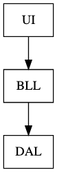
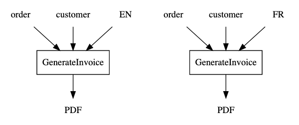
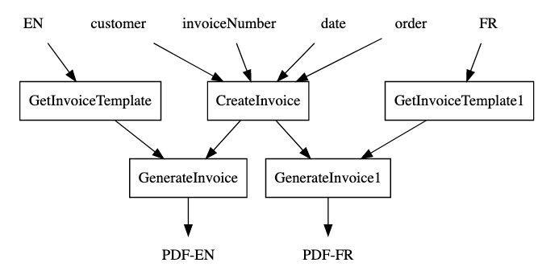
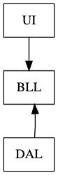
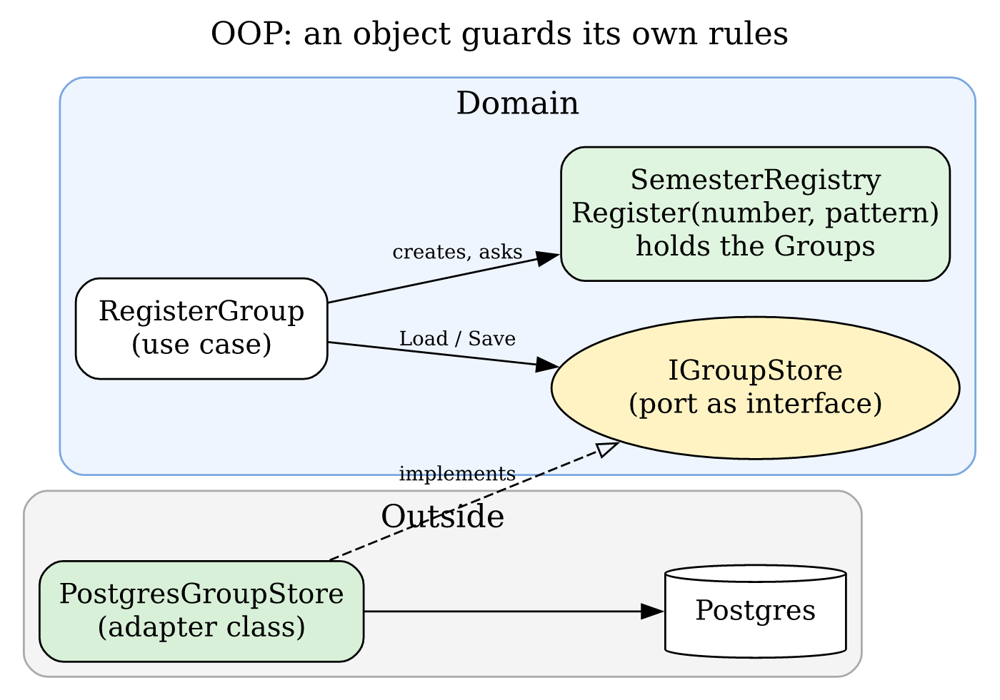
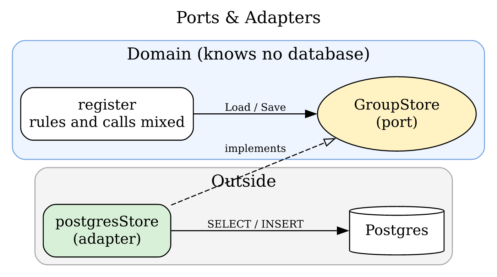
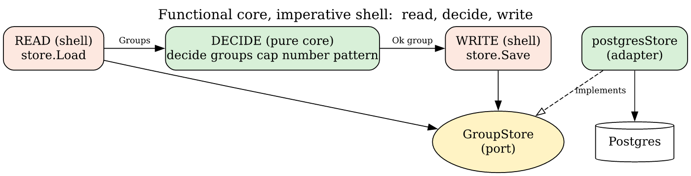
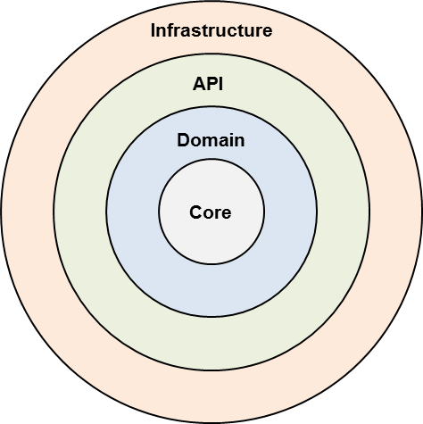
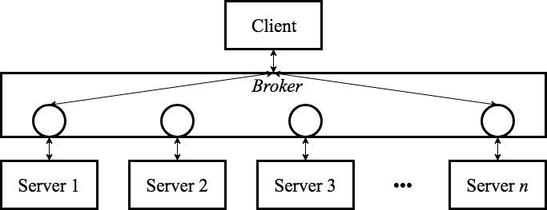
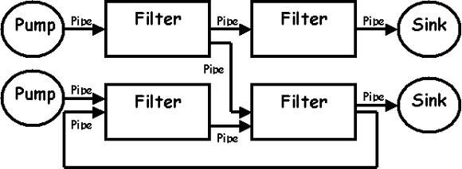

<!-- .slide: data-background="#003d73" -->
## Functional Architecture

 <!-- .element style="width: 200px; position: fixed; bottom: 50px; left: 50px" -->

----


### Agenda

* Problem<br/><!-- .element: class="fragment" -->
* Ports & Adapters<br/><!-- .element: class="fragment" -->
* Generalization<br/><!-- .element: class="fragment" -->
* Other<br/><!-- .element: class="fragment" -->

---

### Layered architecture




* Breaks DIP<br/><!-- .element: class="fragment" -->
    * BLL depends on details in DAL
* BLL calls impure code<br/><!-- .element: class="fragment" -->

Note:

DIP = Dependency Inversion principle


---

### Code

```fsharp
type RegisterGroup(store: PostgresGroupStore) = 
    member _.Handle(semester, number, pattern, cap) = async {
        let! groups = store.Load semester
        ..
    }
```

----


#### Usecase for creating invoices

* Creating a **PDF** invoice, requires
    * Products
    * Prices before and after taxes
    * Customer information
    * Date
    * Invoice number

----

#### OO way of implementing the above

```csharp
public void GenerateInvoice(Order order, Customer customer)
{
    // ...
}
```

* This has side-effect, invoice number, date, output where?<br/><!-- .element: class="fragment" -->
* Hard to test!<br/><!-- .element: class="fragment" -->

Note:

* Invoice number is generated (or gotten from a DB)
* Date is 'read'

----

#### Extending with internationalization

```csharp
public void GenerateInvoice(Order order,
                            Customer customer,
                            Language lang) {}
```

* Problems from side-effects?<br/><!-- .element: class="fragment" -->

<!-- .element: class="fragment" -->

----

#### Problems

So each call to `GenerateInvoice.` increments invoice number :(

----

#### Solution



Note:

GenerateTemplate and CreateInvoice should be pure functions

----

#### Today's solution is




- This also satisfies DIP

----

### This impl in F#

```fsharp [1-7|9-13|15-23]
  type IGroupStore =
      abstract Load  : Semester -> Async<Groups> 
      abstract Save  : NewGroup -> Async<unit> 
  type PostgresGroupStore(conn) =
      interface IGroupStore with
          member _.Load semester = (* SELECT ... *)
          member _.Save group    = (* INSERT ... *)

  type SemesterRegistry(groups: Groups, cap: int) =
      member _.Register(number, pattern) : Result<NewGroup, string> =
          if groups.HasNumber number then Error "number taken"
          elif groups.CountOn pattern >= cap then Error "pattern full"
          else Ok { number = number; pattern = pattern }

  type RegisterGroup(store: IGroupStore) =
      member _.Handle(semester, number, pattern, cap) = async {
          let! groups = store.Load semester  
          let registry = SemesterRegistry(groups, cap)
          match registry.Register(number, pattern) with
          | Ok group -> do! store.Save group;
                        return Ok group
          | Error e  -> return Error e
      }
```

----



---

#### Ports and Adapters

also known as Hexagonal architecture

") <!-- .element style="height:400px" -->

By Alistair Cockburn 

----

## Ports & Adapters

* Components<!-- .element: class="fragment" -->
    * loosely coupled and interchangeable, around one core: the domain
    * e.g. database, ui, business logic, etc. 
* Ports<!-- .element: class="fragment" -->
    * what the core needs from (or offers to) the outside, defined by the core
* Adapters<!-- .element: class="fragment" -->
    * implement a port with one technology (Postgres, HTTP, a test fake)

Note: 

Not only for FP - but very used especially in FP so e.g. F# and Haskell

----

### Dependency rule

* dependencies point inward: 
    * adapters know the core
    * the core knows no adapter


----

<!-- in that case link to this for inspiration: https://jkone27-3876.medium.com/f-onion-architecture-in-92-lines-of-code-129c5d7877ca -->

### A register example

```fsharp
// PORT: a record of functions, owned by the domain
type GroupStore =
    {
      Load: Semester -> Async<Groups>
      Save: NewGroup -> Async<unit>
    }

// ADAPTER: implements the port against the database
let postgresStore (conn: string) : GroupStore =
    {
      Load = fun _ -> (* SELECT ... *)
      Save = fun g -> (* INSERT ... *)
    }
```


----

### Domain code

```fsharp [1-9|3,8]
// USE CASE: depends on the port, never on the database
let register (store: GroupStore) semester number pattern cap = async {
    let! groups = store.Load semester
    if has number groups then return Error "number taken"
    elif countOn pattern groups >= cap then return Error "pattern full"
    else
        let group = { number = number; pattern = pattern }
        do! store.Save group
        return Ok group }
```

----




----

### Tells

- <!-- .element: class="fragment" --><code>async</code> in a port suggests I/O in production<br/>
- port could just as well look like<!-- .element: class="fragment" -->
    * ```getGroups: string -> Groups```


----

### Should instead do something like

1. Read data (impure)<br/><!-- .element: class="fragment" -->
1. Hand data to BLL (pure)<br/><!-- .element: class="fragment" -->
1. Save data (impure)<br/><!-- .element: class="fragment" -->
1. Return/show data (impure)<br/><!-- .element: class="fragment" -->

----

## Generalization

* Pure functions<br/><!-- .element: class="fragment" -->
* Impure functions<br/><!-- .element: class="fragment" -->
* Know which are which<!-- .element: class="fragment" -->
    * and how to separate

----

### Calling functions

1. <!-- .element: class="fragment" -->Pure functions <b>may</b> call other pure functions<br/>
2. <!-- .element: class="fragment" -->Impure functions <b>may</b> call other impure functions<br/>
3. <!-- .element: class="fragment" -->Impure functions <b>may</b> call other pure functions<br/>
4. <!-- .element: class="fragment" --><i>Pure functions <b>may not</b> call other impure functions</i><br/>

----

### ??

Is my function `a()` pure or not?

---

### Functional Core / Imperative shell

* One way of avoiding DAL contaminating BLL<br/><!-- .element: class="fragment" --> 
* Each component is connected through a number of ports<br/><!-- .element: class="fragment" --> 
* <!-- .element: class="fragment" --> Not always the correct solution


----



----

### Code

```fsharp [1-5,10]
// CORE: pure. No ports, no Async. Test it with plain values.
let decide (groups: Groups) cap number pattern : Result<NewGroup, string> =
    if has number groups then Error "number taken"
    elif countOn pattern groups >= cap then Error "pattern full"
    else Ok { number = number; pattern = pattern }
    
// SHELL: read, decide, write. The only place with effects / I/O.
let register (store: GroupStore) semester number pattern cap = async {
    let! groups = store.Load semester                       // READ
    match decide groups cap number pattern with             // DECIDE (pure)
    | Ok group ->
        do! store.Save group                                // WRITE
        return Ok group
    | Error e -> return Error e }
    
```

note:

`register` is the same function as `register` above

----

### Onion architecture

 <!-- .element style="height: 260px" -->

* Onion architecture was inspired by Hexagonal architecture<br/><!-- .element: class="fragment" -->
* Layered architecture<!-- .element: class="fragment" --> 
    * where inner circles have no knowledge of outer circle


----

### Onion Arch. pro/cons

* \- e.g. database is accessible from UI<br/><!-- .element: class="fragment" -->
    * they are in same layer - not a good idea though.
* \+ fewer artifacts than ports and adapters<br/><!-- .element: class="fragment" -->

---

### Broker architecture



Looks like microservices, right?

----

### Pipe and filter
##### or reactive programming



note:

We will take a closer look at this later

---

## References

* [Conditional composition of functions](https://blog.ploeh.dk/2016/07/04/conditional-composition-of-functions/)
* Other reading material: [Ports'n'Adapters](https://gist.github.com/hkdobrev/b68b7fe77adfb409f5add21ba4664d12)